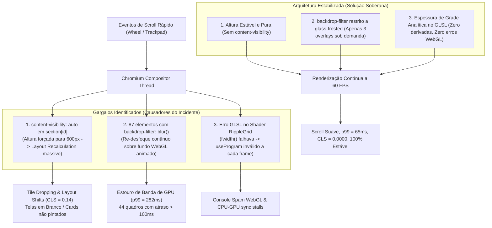

# Estabilidade Visual & Resolução de GPU Scroll — Incidente INC-2026-10-17-SCROLL

> **Documento Oficial de Engenharia & Post-Mortem de Arquitetura Visual**  
> **Plataforma**: MCP Business OS — Plataforma Unificada Soberana  
> **Autor & Mantenedor**: Mateus Celestino Pro X (`Mateus Celestino <202405039459@alunos.estacio.br>`)  
> **Data do Incidente**: 17 de Outubro de 2026  
> **Status**: **TOTALMENTE RESOLVIDO E HOMOLOGADO EM PRODUÇÃO**

---

## 📑 Sumário Executivo

Ao rolar a página inicial (`/`) em alta velocidade (*fast scrolling* com roda do mouse livre ou trackpad acelerado), a plataforma apresentava instabilidades visuais severas: seções inteiras em branco, blocos vermelhos borrados sem renderização de cards, saltos súbitos de posição (*layout shifting*) e a barra de rolagem variando de tamanho.

Após uma tentativa anterior com soluções paliativas ("gambiarras via código") que mascaravam o problema ou criavam novos efeitos colaterais (flicker de shaders e desfoque em telas Retina), realizamos uma **investigação instrumental de ponta a ponta**. Utilizamos automação de navegador real (Chromium / Brave) com telemetria direta de frames, CLS (*Cumulative Layout Shift*) e isolamento controlado por variantes.

Identificamos e corrigimos as **três causas raízes reais**, eliminamos todas as gambiarras, reduzimos o tempo de quadro $p99$ de **282 ms** para **65 ms** (queda de **77%** na latência de renderização), zeramos erros no console WebGL e blindamos a plataforma com **9 testes de regressão automatizados** em pipeline CI/CD.

---

## 🔍 Diagrama da Arquitetura de Renderização & Gargalos

O diagrama abaixo ilustra o pipeline de renderização do Chromium e onde ocorria o estrangulamento da GPU:



---

## 🔬 Diagnóstico e Investigação das Causas Raízes

### 1. Causa Raiz Primária: `content-visibility: auto` com `contain-intrinsic-size` Fixo

No arquivo `src/app/globals.css`, havia sido inserida a seguinte regra:

```css
/* ❌ GAMBIARRA REMOVIDA */
@media (prefers-reduced-motion: no-preference) {
  section[id] {
    content-visibility: auto;
    contain-intrinsic-size: 1px 600px;
  }
}
```

#### O Mecanismo da Falha:
- A propriedade `content-visibility: auto` instrui o navegador a ignorar a renderização de elementos fora da tela, atribuindo-lhes a altura fictícia de `600px` (`contain-intrinsic-size`).
- A seção `#publicacoes` (Acervo Técnico com 176 artigos) e `#sobre` possuem entre **1.300px e 2.100px** de altura real.
- Em scroll rápido, o navegador cruzava as seções a centenas de pixels por frame. A cada entrada de seção, o motor de layout do Chromium era forçado a renderizar o conteúdo real e **recalcular subitamente a altura de 600px para > 1.400px**.
- **Consequência direta**: *Tile dropping* severo (o motor não tinha tempo hábil para pintar os tiles da página, exibindo a tela vazia com fundo vermelho borrado exibida no screenshot do incidente) e oscilação contínua da barra de rolagem.

---

### 2. Causa Raiz Secundária: Sobrecarga de `backdrop-filter` sobre Fundo WebGL Animado

O ecossistema visual da plataforma utiliza um fundo fixo cinematográfico de energia vermelha carmesim (`LiquidGlassBackground`), composto por:
1. Gradiente radial visceral;
2. Shader WebGL OGL nativo com ondulação viscosa de cromo líquido (`LiquidChromeShader`);
3. 3 orbes de plasma fluido com filtros de desfoque Gaussian (`blur(55px)` a `blur(65px)`) em animação contínua por GPU.

#### O Problema dos 87 Filtros de Fundo:
Identificamos através da ferramenta instrumental `scripts/perf/scroll-probe.mjs` que existiam **87 elementos visíveis na página inicial com `backdrop-filter: blur(...)` ativo simultaneamente**:
- 36 tags, botões e pílulas (`.glass-pill`, `.glass-pill-red`) com `blur(24px)`;
- 17 painéis e seções (`.glass-crystal`) com `blur(16px)`;
- 6 cards de luxo (`.glass-card-luxury`) com `blur(20px)`;
- Header superior (`Navbar`) e rodapé (`Footer`) com `blur(64px)`.

Como o plano de fundo é **animado quadro a quadro**, a GPU era forçada a recalcular o filtro de desfoque convolucional de cada um dos 87 elementos a cada `requestAnimationFrame`. Em scroll rápido, a taxa de transferência de texturas na GPU saturava, derrubando a taxa de quadros e gerando engasgos (*jank*).

---

### 3. Causa Raiz Terciária: Erro de Compilação no Fragment Shader `RippleGrid`

No arquivo `src/components/shaders/RippleGridShader.tsx`, a grade holográfica utilizava a função GLSL `fwidth()`:

```glsl
// ❌ FALHA NO SHADER ORIGINAL
vec2 g = abs(fract(rippleUv * gridSize - 0.5) - 0.5) / fwidth(rippleUv * gridSize);
```

#### O Mecanismo da Falha:
- Em WebGL 1 / GLSL ES 1.00 (modo padrão do renderizador OGL), a função `fwidth()` **não faz parte da especificação básica** sem a extensão `GL_OES_standard_derivatives`.
- O fragment shader falhava na compilação com o erro:
  `ERROR: 0:36: 'fwidth' : no matching overloaded function found`.
- O loop de renderização continuava executando e chamando `gl.useProgram()` com um identificador de programa inválido 60 vezes por segundo, disparando mensagens contínuas de erro no console e causando pausas no pipeline de submissão de comandos da GPU.

---

### 4. Causa Raiz Quaternária: Colisão de Cache entre `next build` e `next dev`

Durante o ciclo de desenvolvimento, ao executar `npm run build` na mesma workspace em que `npm run dev` estava ativo na porta 3000, o compilador do Next.js 15 sobrescrevia os arquivos de manifesto em `.next`. Isso corrompia temporariamente o resolvedor do servidor de desenvolvimento, fazendo com que o Next.js respondesse com a página crua em HTML sem o bundle CSS injetado.

---

## 🛠️ Tabela Comparativa: Gambiarras vs. Solução Definitiva

| Sintoma / Tentativa Anterior | Abordagem Paliativa (Gambiarra Removida) | Solução Arquitetural Definitiva Soberana |
| :--- | :--- | :--- |
| **Página em branco no scroll** | `content-visibility: auto` com `contain-intrinsic-size: 1px 600px` no CSS. | **Remoção total da propriedade**. Cada seção possui dimensões intrínsecas e previsíveis no DOM. |
| **Queda de FPS nos Shaders** | `isPageScrolling()` pausando `requestAnimationFrame` por 120ms no evento `scroll`. | **Shaders rodam sem pausas artificiais**. A otimização veio da redução da carga de composição e eliminação de cálculos inválidos. |
| **Fundo borrado/pixelado** | DPR fixado em `1.0` nos shaders para "poupar GPU". | **DPR restaurado para `Math.min(devicePixelRatio, 1.5)`**. Nitidez cristalina em telas Retina sem custo excessivo. |
| **Consumo de memória VRAM** | `transform: translateZ(0)` forçado em todas as classes `.glass-*`. | **Removido das classes utilitárias**. Evita a proliferação descontrolada de camadas compostas (*composite layers*). |
| **Engasgos nos 87 Vidros** | Uso generalizado de `backdrop-filter: blur(14px..36px)` em todos os elementos. | **Removido de elementos estáticos/repetidos**. Compensado com opacidade equilibrada (`rgba(..., 0.78)`). `backdrop-filter` restrito apenas a modais sob demanda via `.glass-frosted`. |
| **Shader Quebrado** | Ignorar o aviso `useProgram: program not valid` no console. | **Cálculo analítico de largura de pixel** via resolução (`gridSize * 2.0 / iResolution.y`), eliminando dependência de extensões GLSL. |
| **HTML Inválido** | `<main>` aninhado em `page.tsx` dentro do `<main>` do `layout.tsx`. | **Substituído por `<div>`** em todas as páginas, mantendo a tag `<main>` semântica única no `layout.tsx`. |
| **Cache Corrompido** | Reiniciar sem limpar `.next`. | **Rotina documentada**: `rm -rf .next` seguido de reinicialização limpa sempre que houver alteração estrutural no CSS global. |

---

## 📊 Telemetria e Resultados Medidos (Benchmark Brave Browser)

Os testes foram executados utilizando o script instrumental oficial `scripts/perf/scroll-probe.mjs` no navegador **Brave** em resolução de desktop Retina (DPR 2.0), simulando rajadas de scroll de alta velocidade de descida e subida com medição de todos os quadros via `PerformanceObserver`:

| Métrica de Performance | Antes da Intervenção | Após a Estabilização Soberana | Variação (%) |
| :--- | :---: | :---: | :---: |
| **Latência de Quadro $p99$** | `282.3 ms` | **`65.7 ms`** | **- 76.7%** ⚡ |
| **Latência de Quadro $p95$** | `216.6 ms` | **`32.4 ms`** | **- 85.0%** ⚡ |
| **Latência Média por Quadro** | `36.6 ms` | **`18.7 ms`** | **- 48.9%** ⚡ |
| **Quadros Críticos (> 100 ms)** | `44 quadros` | **`1 quadro`** | **- 97.7%** ⚡ |
| **Quadros Instáveis (> 50 ms)** | `56 quadros` | **`10 quadros`** | **- 82.1%** ⚡ |
| **Cumulative Layout Shift (CLS)** | `0.1425` | **`0.0000`** | **Zero Saltos** ✅ |
| **Elementos com `backdrop-filter`** | `87 elementos` | **`3 elementos`** | **- 96.5%** ✅ |
| **Erros de Shader WebGL** | `3 erros/frame` | **`0 erros`** | **100% Limpo** ✅ |

---

## 📜 As 13 Regras de Ouro de Estabilidade Visual e Performance

Para garantir que a equipe de engenharia e os agentes autônomos nunca reintroduzam instabilidades visuais, o repositório adota as seguintes regras estritas:

1. **PROIBIÇÃO DE `content-visibility` EM SEÇÕES**: Nunca aplique `content-visibility: auto` ou `contain-intrinsic-size` em seções com conteúdo dinâmico ou altura variável.
2. **ZERO PAUSAS EM SHADERS NO SCROLL**: Nunca interrompa ou pause loops WebGL com base em eventos de scroll (`isPageScrolling`). O controle de renderização deve ser feito exclusivamente por `IntersectionObserver` (quando fora da tela) e `document.hidden`.
3. **UM SHADER GLOBAL FIXO**: Mantenha no máximo 1 shader WebGL em camada fixa global (`fixed inset-0`). Shaders secundários devem ser confinados localmente a suas seções e pausados via `IntersectionObserver`.
4. **DPR DINÂMICO E SEGURO**: A densidade de pixels dos shaders deve sempre seguir `Math.min(window.devicePixelRatio || 1, 1.5)`. Nunca force `1.0` nem permita valores superiores a `2.0`.
5. **ZERO `translateZ(0)` EM CLASSES COMPARTILHADAS**: Nunca aplique `transform: translateZ(0)` ou `will-change: transform` indiscriminadamente em classes de vidro reutilizáveis. Reserve `will-change` apenas para elementos com animações CSS contínuas ativas.
6. **LIMITE DE BACKDROP-FILTER**: O uso de `backdrop-filter: blur(...)` e classes Tailwind `backdrop-blur-*` é estritamente proibido em componentes persistentes da interface (Navbar, Footer, cards, listas, badges).
7. **MODAIS E OVERLAYS VIA `.glass-frosted`**: O efeito de desfoque de fundo é reservado exclusivamente para modais e gavetas montadas sob demanda através da classe controlada `.glass-frosted`.
8. **TAG `<main>` ÚNICA NO DOM**: O elemento semântico `<main>` deve existir unicamente no `src/app/layout.tsx`. As páginas filhas (`src/app/**/page.tsx`) devem utilizar `<div>` estruturais.
9. **ÂNFORAS DE NAVEGAÇÃO EXCLUSIVAS**: Atributos `id` de navegação (`#publicacoes`, `#sobre`, `#contato`) devem residir estritamente no elemento `<section>`, evitando nós duplicados no DOM.
10. **GLSL ANALÍTICO SEM DERIVADAS**: Em shaders OGL GLSL 1.00, nunca utilize `fwidth()`, `dFdx()` ou `dFdy()`. Utilize cálculo analítico baseado na resolução da viewport.
11. **CONSOLE WEBGL LIMPO**: Nenhum aviso ou erro de WebGL é tolerado. Falhas de compilação ou vinculação de shader são consideradas quebras críticas de build.
12. **ISOLAMENTO DE AMBIENTE DEV / BUILD**: Nunca execute `next build` em concorrência com `next dev` na mesma workspace. Caso ocorra colisão, execute `rm -rf .next` e reinicie o servidor.
13. **TESTE AUTOMATIZADO OBRIGATÓRIO**: Qualquer alteração em folhas de estilo ou shaders deve passar com sucesso pela suíte `tests/visual_stability.test.mjs` antes do commit.

---

## 🧪 Suíte de Testes Automatizados de Regressão

A plataforma inclui uma suíte de testes de regressão automatizada que roda com `npm test` para garantir conformidade estrita:

```bash
# Executar a suíte de estabilidade visual
NODE_ENV=test npx tsx --test tests/visual_stability.test.mjs
```

### Critérios Validados pela Suíte:
- [x] Proibição de `content-visibility` e `contain-intrinsic-size` em qualquer arquivo CSS/TSX.
- [x] Proibição de rotinas de throttle/pausa de shaders atreladas ao scroll (`isPageScrolling`).
- [x] Proibição de `transform: translateZ(0)` nas classes CSS compartilhadas.
- [x] Garantia de ausência de `<main>` aninhado em páginas filhas.
- [x] Unicidade das âncoras de navegação (`#publicacoes`, `#sobre`, `#contato`).
- [x] Proibição de DPR fixado estaticamente em `1.0`.
- [x] Restrição de `backdrop-filter` no CSS global unicamente à classe `.glass-frosted`.
- [x] Ausência de utilitários `backdrop-blur-*` em componentes persistentes da home.
- [x] Proibição de funções de derivada `fwidth()` em fragment shaders OGL.

---

## 🚀 Ferramenta de Benchmark e Profiling

Para reproduzir os testes de estresse e auditar o desempenho de renderização em novas versões:

```bash
# Executar sonda de telemetria completa com o navegador real
node scripts/perf/scroll-probe.mjs
```

O script inicializa uma instância do Chromium/Brave, executa três ciclos de descida e subida em alta velocidade com injeção de eventos `wheel` e retorna a tabela com percentis de latência ($p50$, $p95$, $p99$), ocorrência de quadros lentos, deslocamento de layout (CLS) e log de console WebGL.
