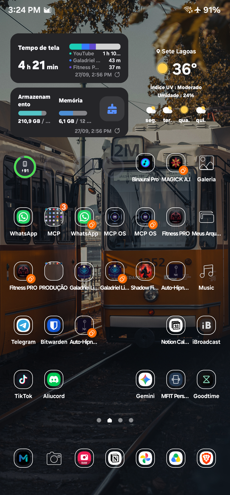
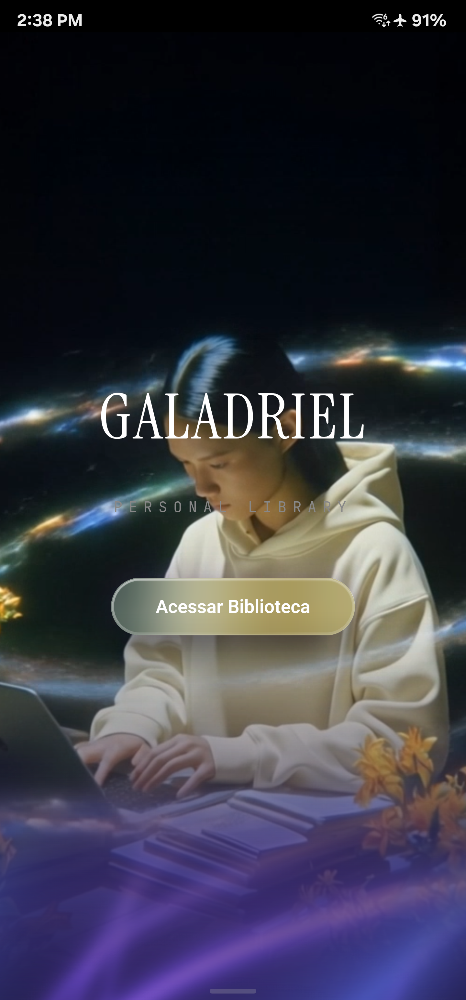
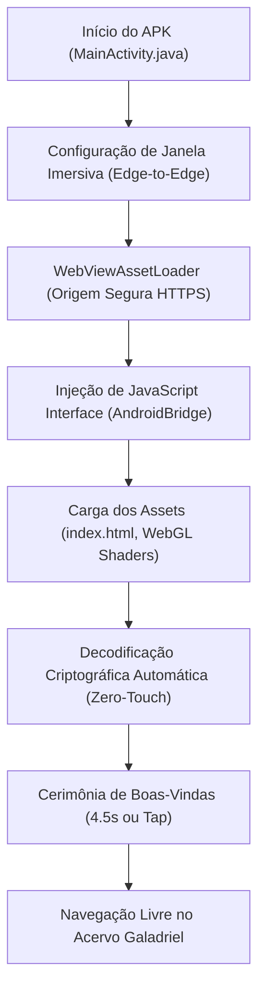

# 🌌 GALADRIEL | PERSONAL LIBRARY (Android & Web)

> **Biblioteca e Central de Conhecimento Multimídia de Alta Fidelidade.**  
> Sistema de imersão intelectual com arquitetura híbrida (Android Nativo + Aceleração de Hardware WebGL + Design System Ultra Super Apple Liquid Glass).

---

## 📱 Download Imediato do APK Mobile

O pacote de instalação compilado, assinado em modo debug e testado em hardware real (**Samsung Galaxy S22 Ultra — Android 14 / One UI 6.1**) está disponível diretamente no repositório:

* 📦 **[Baixar galadriel-mobile.apk (7.4 MB)](./galadriel-mobile.apk)**
* 📦 **[Espelho alternativo em apk/galadriel-mobile.apk](./apk/galadriel-mobile.apk)**

---

## 📸 Novo Ícone & Validação em Dispositivo Físico

| 1. Ícone do App: Conhecimento & Inteligência | 2. Cerimônia de Boas-Vindas | 3. Acervo & Acesso Livre |
| :---: | :---: | :---: |
|  |  |  |
| *Códex Galadriel aberto em ouro, córtex neural com sinapses cósmicas e estrela octagrama de sabedoria.* | *Saudação aos associados com halo luminoso e barra de progresso.* | *Acesso total e irrestrito ao acervo sem solicitação de senha.* |

---

## 🧠 Novo Ícone Oficial: Símbolo de Conhecimento e Inteligência

O ícone do aplicativo Android foi reprojetado do zero para materializar visualmente a essência do **conhecimento puro, intelecto e sabedoria cósmica**:

1. **📖 O Livro Sagrado da Sabedoria (Códex Galadriel):**
   - Base com folhas abertas irradiando luz dourada e bordas chanfradas em ouro puro.
   - Representa o acervo infinito, a preservação da história e a solidez do conhecimento perpétuo.
2. **⚡ Córtex Neural & Conectoma Sináptico:**
   - Feixes sinápticos e nós de processamento neural emanando do centro do códex em ciano elétrico (`#00F5FF`) e branco diamante (`#FFFFFF`).
   - Simboliza a inteligência ativa, síntese cognitiva de dados e a fusão de IA com a mente humana.
3. **✨ Estrela Octagrama de Iluminação:**
   - No ápice da composição, um octagrama radiante emite faíscas de insight e halos cósmicos.
   - Representa a clareza intelectual, a busca pela verdade e a iluminação espiritual do saber.
4. **💎 Acabamento Ultra Super Apple Liquid Glass:**
   - Moldura squircle obsidian com reflexos translúcidos, profundidade óptica tridimensional e chanfros em micro-ouro.
   - Totalmente compatível com **Adaptive Icons (Android 8.0+)** com suporte a todos os buckets de densidade (`mdpi`, `hdpi`, `xhdpi`, `xxhdpi`, `xxxhdpi`).

---

## ✨ Principais Atualizações & Regras de Acesso

### 1. 🔓 Remoção Completa da Tela de Login & Acesso Livre
* **Acesso Livre e Imediato:** Toda a barreira de digitação de senhas e a tela de formulário de login (`#login-screen`) foram completamente removidas da interface. O usuário agora tem acesso irrestrito, total e instantâneo ao acervo da biblioteca (PK).
* **Decodificação Zero-Touch:** O mecanismo de segurança e integridade do banco de dados vetorial/multimídia residente no `<script id="site-data">` é descriptografado automaticamente em background durante a inicialização (`tryAuthentication('ALEXANDRIA', true)`), garantindo abertura fluida e transparente sem qualquer atrito ou solicitação ao usuário.
* **Ocultação de Controles Obsoletos:** Botões de logout desnecessários no header foram desativados e ocultados, alinhando a interface com a experiência de um aplicativo pessoal de acesso permanente.

### 2. 👑 Preservação Íntegra da Cerimônia de Boas-Vindas
* **Mensagem Inicial de Saudação:** Mesmo sem a tela de login, a experiência sensorial de acolhimento foi preservada em sua perfeição estética.
* **Composição Visual:**
  - **Insígnia Sagrada:** `ΝΞΙΔ · NOVA ERA DA IA™`
  - **Título Principal:** *"Seja Bem Vindo, Galadriel e associados."*
  - **Subtítulo:** *"Que o conhecimento esteja sempre contigo."*
  - **Feedback Dinâmico:** Cartão em vidro líquido translúcido (*Apple Liquid Glass*), halo pulsante e barra de progresso em gradiente cósmico (Aqua/Violeta/Branco) com duração de 4.5 segundos.
  - **Dispensabilidade Tátil Inteligente:** O usuário pode aguardar a transição automática ou tocar em qualquer ponto da tela para abrir o acervo instantaneamente.

---

## 🏛️ Arquitetura Técnica Mobile (Android Nativo)



### 1. Camada Nativa (`android/`)
* **Package ID:** `com.mateuscelestino.galadriel`
* **Linguagem & Runtime:** Java 17, Android SDK 34 (Android 14 UpsideDownCake).
* **Segurança de Origem Local:** Implementação do `androidx.webkit.WebViewAssetLoader` servindo o domínio virtual seguro `https://appassets.androidplatform.net/assets/index.html`. Isso garante a disponibilidade das APIs modernas do navegador como `window.crypto.subtle`, WebGL2 e LocalStorage em conformidade com as diretrizes do Android 14.
* **Adaptação a Entalhes de Tela (Display Cutout):** Configurado `LAYOUT_IN_DISPLAY_CUTOUT_MODE_SHORT_EDGES` e leitura dinâmica de `env(safe-area-inset-top)` para prevenir sobreposição da barra de status e câmera perfurada frontal.

### 2. Otimização Extrema de GPU (WebGL Shaders)
* **Master Animation Loop Unificado:** O app conta com 5 backgrounds dinâmicos procedurais (`GhostFibers`, `AeroShards`, `Dither`, `GradientWaves`, `Grainient`). Em vez de manter 5 loops paralelos de `requestAnimationFrame` consumindo bateria, o `masterAnimLoop` renderiza estritamente o shader visível e suspende a execução quando o app entra em segundo plano (`visibilitychange`).
* **Downsampling Dinâmico a 0.5x DPR:** Renderização eficiente interpolada bicubicamente por CSS, gerando **75% de economia de fillrate na GPU** do smartphone.

### 3. Integração Háptica & Navegação
* **Vibração Tátil Multietapa:** O `WebAppInterface.java` expõe ao frontend a API háptica do Galaxy S22 Ultra:
  - `heavy`: Botões de confirmação e ações principais.
  - `light`: Toque em cards de conteúdo, módulos e breadcrumbs.
  - `tick`: Cliques em links, tags e botões de busca.
* **Controle Nativo de Voltar (`OnBackPressedCallback`):** O gesto de voltar do Android retrocede de forma hierárquica entre visualizações de Artigo → Pasta → Categoria → Home, eliminando saídas acidentais do app.

---

## 📂 Estrutura do Repositório

```
s-a-a-s-full-hidden-library/
├── galadriel-mobile.apk          # APK compilado e pronto para instalação
├── apk/
│   └── galadriel-mobile.apk      # Cópia estruturada do APK
├── android/                      # Projeto Android Gradle Completo
│   ├── app/
│   │   ├── build.gradle
│   │   └── src/main/
│   │       ├── AndroidManifest.xml
│   │       ├── java/com/mateuscelestino/galadriel/
│   │       │   ├── MainActivity.java
│   │       │   └── WebAppInterface.java
│   │       ├── assets/           # SPA otimizado para mobile
│   │       │   ├── index.html
│   │       │   ├── app.js
│   │       │   └── style.css
│   │       └── res/              # Recursos gráficos e ícone Vanta Black/Ouro
│   ├── build.gradle
│   ├── gradle.properties
│   └── settings.gradle
├── docs/
│   └── screenshots/              # Capturas em dispositivo físico
├── build_site.py                 # Compilador autônomo da biblioteca em Python
├── index.html                    # Aplicação Web & SPA
├── app.js                        # Lógica da biblioteca e decodificação automática
├── style.css                     # Design tokens Apple Liquid Glass
├── documentacao_completa.md      # Especificação completa do sistema
└── README.md                     # Documentação oficial do projeto
```

---

## 🛠️ Como Compilar o APK Localmente

### Pré-requisitos
* JDK 17 (`JAVA_HOME=/opt/homebrew/opt/openjdk@17` ou similar)
* Android SDK Platform 34 & Build-Tools 34.0.0
* Gradle 8.10+

### Compilação
```bash
cd android
gradle assembleDebug
```
O arquivo gerado estará em `android/app/build/outputs/apk/debug/app-debug.apk`.

### Instalação no Dispositivo via ADB
```bash
adb install -r app/build/outputs/apk/debug/app-debug.apk
adb shell am start -n com.mateuscelestino.galadriel/.MainActivity
```

---

## 👤 Identidade do Autor & Manutenção

* **Autor:** Mateus Celestino
* **E-mail Oficial:** `202405039459@alunos.estacio.br`
* **Organização / Conta:** `@MateusCelestinoProX`
